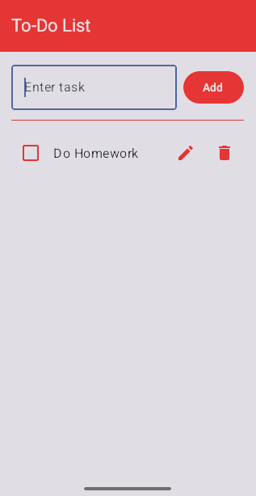

# TaskFlow Android

A local task manager built as a university project with Kotlin, Jetpack Compose, Room, and coroutines.

## Features

- Create, rename, complete, and delete tasks.
- Keep tasks locally between app launches; no account or network access is required.
- Preserve unfinished input across activity recreation.
- Reject blank titles and report failed writes without discarding the draft.

## Structure

- `ui/`: Compose screen and theme.
- `presentation/`: ViewModel, observable UI state, and operation events.
- `domain/`: task model, repository contract, and task creation validation.
- `data/`: Room entities, DAO, database, and repository implementation.

`TodoApplication` owns one database for the app's lifetime. Renaming and changing completion update separate columns so an older screen snapshot cannot overwrite the other field.

## Build and run

Install Android Studio, JDK 21, Android SDK Platform 35, and Build Tools 34.0.0. The Gradle wrapper is included; Kotlin/Java compilation targets JVM 17. The app supports Android 7.0 (API 24) and newer.

Open the project in Android Studio and let it configure the SDK, or set `ANDROID_HOME` to your SDK directory. An alternative is an ignored `local.properties` file containing `sdk.dir=C:/path/to/Android/Sdk`.

From the repository root on Windows:

```powershell
.\gradlew.bat :app:assembleDebug :app:testDebugUnitTest :app:lintDebug
```

On Linux/macOS, use `./gradlew` with the same tasks. The debug APK is written to `app/build/outputs/apk/debug/app-debug.apk`.

Run the `app` configuration in Android Studio on an emulator/device, or install and launch through the CLI:

```powershell
adb install -r app\build\outputs\apk\debug\app-debug.apk
adb shell am start -n com.example.cleantodoapp3/.MainActivity
```

## Tests

Local JVM tests cover title validation, repository errors, asynchronous ViewModel operations, duplicate submission, retries, and cancellation.

Room and Compose instrumentation tests cover database persistence, independent field updates, retained drafts, and failed-write feedback. They require a connected device or emulator:

```powershell
.\gradlew.bat :app:connectedDebugAndroidTest
```

## Screenshot


